# Enemies

With the aim to give non-C++ programmers the ability to develop or adjust the behavior of enemies, all enemies were implemented in `lua`. Inside the folder `data/scripts/enemies` you will find a number of scripts you can use as a reference to implement your own enemies or alter their behavior as needed.

The Deceptus Engine offers two ways to integrate enemies inside your level.

## Adding Enemies

In the early days of the Deceptus Engine enemies were added just by defining a huge list of references to the enemy lua scripts bundled together with a couple of properties such as their start positions or the path they move along.

You can configure enemies by editing the json by hand, or - depending on your liking - directly position enemies inside Tiled.

### Adding Enemies with level.json

The first thing to do is to have a json array `enemies` inside your json file.
```json
  "enemies": [

  ]
```

Next, you have to have one section for each enemy instance inside this array. For this purpose you would usually define the '`script`' as well as '`startposition`' of your enemy. The start position is entered in tile coordinates.
```json
    {
      "script": "ghost.lua",
      "startposition": [233, 82],
      "path": [238, 82]
    },
    {
      "script": "bonefish.lua",
      "startposition": [250, 99],
      "path": [250, 99, 256, 99]
    },
```

All properties that are applicable for each enemy type are listed below.


### Adding Enemies with Tiled

The Tiled approach follows the same concept with the only difference that properties required to configure an enemy are entered through Tiled's Custom Properties. Of course the start position does no longer need to be entered manually since you will just position your enemy inside Tiled.

In order to insert an enemy in your level using the Tiled editor, create an object group called '`enemies`' and insert a rectangle at that location where your enemy should be positioned. Then define all enemy properties inside the Custom Properties, such as


|Custom Property|Type|Description|
|-|-|-|
|script|string|Name of the enemy's lua script|
|path|string|A comma separated list of positions in tile coordinates (x0, y0, x1, y1, etc.)

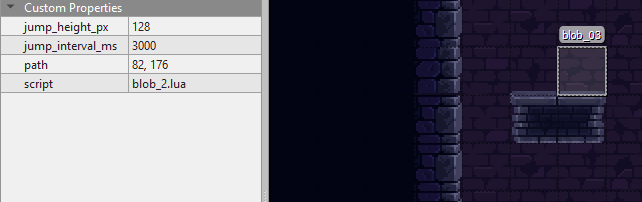


### Adding Enemies with Tiled and level.json

#### Deprecation note
The approach below is not going to be supported for much longer since you can (and should) define all your objects inside your TMX file.

In order to make things a bit more confusing, there's even a third way to place enemies inside your level. And the choice is really up to you, there's no 'wrong' way to do it. In this method, you just place a rectangle object inside your `enemies` object group and remember its _Object ID_.

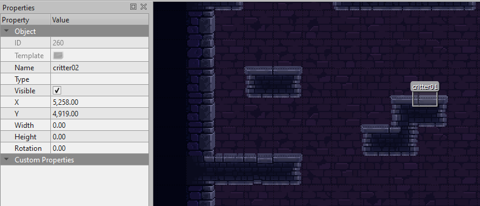

Then, you open up the `level.json` description and add a reference to that object. Now, just add further enemy-related properties to the json as described in the first paragraph of this chapter.

```json
    {
      "script": "critter.lua",
      "id": "260",
      "generate_path" : true
    },
```

Below you will find a description of all enemies including a table of their properties.


## Enemy Design and Properties


### Generic properties
|Property|Type|Description|
|-|-|-|
|z|int|Layer z index where the enemy is located in. This includes projectiles fired by the enemy.|


### Arrow Trap

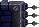

Arrow Traps shoot arrows in a particular direction.

|Property|Type|Description|
|-|-|-|
|script|string|`arrowtrap.lua`|
|alignment|string|Arrow direction: '`up`', '`down`', '`left`', '`right`'|
|time_offset_s|float|An offset for the time when the arrows are fired, given in seconds|


### Bat

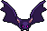

A bat usually sleeps somewhere at the ceiling of a room. When woken up by Adam, it attacks.

|Property|Type|Description|
|-|-|-|
|script|string|`bat_2.lua`|
|script|string|Name of the enemy's lua script|


### Blob

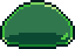

A Blob can either move left and right on the floor or ceiling of a room, jump up and down and actually even jump down and up.

|Property|Type|Description|
|-|-|-|
|script|string|`blob_2.lua`|
|jump_height_px|string|If the Blob should jump, define its jump height in `px`|
|gravity_scale|float|If the Blob should walk the ceiling instead of the floor, you can set its gravity scale to `-1.0`. It'll go positive once the Blob is right over Adam. Then it'll fall down.|
|jump_interval_ms|int|If the Blob should jump, you have to define its jump interval (in `ms`).|
|path|string|Usually you would only define a 2nd x,y-position here which will make the Blob go back and forth between its start position and the other position. You can also enter more than one position if needed. Format: `x0, y0, x1, y1, etc.`|


### Bonefish

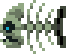

|Property|Type|Description|
|-|-|-|
|script|string|`bonefish.lua`|
|path|string|Usually you would only define a 2nd x,y-position here which will make the Bonefish go back and forth between its start position and the other position. Format: `x0, y0, x1, y1, etc.`|
|speed|float|Movement speed (default is `1.0`)|
|frequency|float|Movement sine wave frequency (default is `1.0`)|
|amplitude|float|Movement sine wave amplitude (default is `1.0`)|


### Cannon

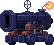

Well... it's a cannon. It fires... cannon balls.

|Property|Type|Description|
|-|-|-|
|script|string|`cannon_2.lua`|
|alignment|string|Cannons either point to the '`left`' or to the '`right`'.|
|time_offset_s||float|Timing offset (in seconds) to avoid firing all cannons at the same time|
|fire_interval_s|float|The interval used for firing the cannon (in seconds)|


### Critter

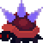

Small spiky enemy that can crawl up walls and simply goes its way round and round and round without ever getting tired.

|Property|Type|Description|
|-|-|-|
|script|string|`critter.lua`|
|generate_path|bool|If `true`, the Deceptus Engine will automatically trace the edge the Critter has been placed on and turn it into a path. Then the Critter will follow this path. This only works for closed loops.|
|inverse_path|bool|If `true`, the inverse path will be generated, i.e. the critter will move the opposite way.|


### Ghost

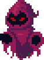

Ghosts fly around following a given path. When Adam gets close by, they try to scare him away.

|Property|Type|Description|
|-|-|-|
|script|string|`ghost.lua`|
|path|string|The ghosts path given as a list of x,y-positions; format: `x0, y0, x1, y1, etc.`|


### Insect

A tiny wall dweller that wanders around, takes a break, then carries on. It is harmless by default
and uses the same Lua enemy system as the other creatures.

#### Placement

1. Open or create an object group named `enemies` in Tiled.
2. Place [enemy_insect.tx](../../data/templates/enemy_insect.tx) in that group, or draw a rectangle
   and add the string property `script` with the value `insect.lua`.
3. Resize the rectangle over the wall area where the insect should roam. The template starts at
   96 x 96 pixels; use at least 24 x 24 pixels to fit the entire sprite.
4. Set `z` so the insect draws in front of the wall graphics. The template suggests `20`.

Each rectangle spawns one insect at its center. The rectangle defines its movement area;
it does not need a patrol path. The insect moves across the wall artwork without following
tile collision shapes, so keep the rectangle within the intended wall surface.

#### Behavior

1. Pick a random direction from the eight directions that allow movement inside the rectangle.
2. Walk straight for a newly sampled duration between `walk_duration_min_ms` and
   `walk_duration_max_ms` (1000–2000 ms by default), stopping early at a boundary.
3. Rest in place, facing the same direction, for a newly sampled duration between
   `rest_duration_min_ms` and `rest_duration_max_ms` (3000–4000 ms by default).
4. Return to step 1. The next choice may be the same direction if there is still room to walk.

Diagonal movement has the same speed as horizontal and vertical movement. At a boundary,
the next walk excludes directions that would immediately leave the rectangle. Bounds are inset
by half a sprite frame so the whole insect stays inside. In a rectangle too narrow for a full
frame, the insect stays centered on that axis; when neither axis allows movement, it only idles.

#### Properties

|Property|Type|Default|Description|
|-|-|-|-|
|script|string|`insect.lua`|Script to select when placing the insect manually.|
|speed|float|12|Walking speed in pixels per second; must be positive.|
|walk_duration_min_ms|int|1000|Minimum walking duration in milliseconds; must be positive.|
|walk_duration_max_ms|int|2000|Maximum walking duration in milliseconds; must be positive.|
|rest_duration_min_ms|int|3000|Minimum resting duration in milliseconds; must be positive.|
|rest_duration_max_ms|int|4000|Maximum resting duration in milliseconds; must be positive.|
|damage|int|0|Contact damage; zero makes the insect harmless. Its sensor does not block the player.|
|z|int|20 in the template|Draw depth; choose a value in front of the wall graphics.|

For example, set `speed` to `8`, the walking range to `500`–`1000`, and the resting range to
`4000`–`6000` for a slower insect that takes short walks and long breaks. Set either range's
minimum and maximum to the same value for a fixed duration. Reversed endpoints are accepted;
invalid numeric values leave the current setting unchanged.

For JSON-only placement, `region_width_px` and `region_height_px` configure the movement area
and default to 96 pixels each. The start position defines the area's upper-left corner using
the usual enemy tile coordinates. In Tiled these dimensions come directly from the rectangle,
so there is no need to enter them as custom properties.

#### Artwork and animation

The [Lua script](../../data/scripts/enemies/insect.lua) uses
[insect.png](../../data/sprites/insect.png), a 216 x 192 pixel sheet with 24 x 24 pixel frames.
Each row contains four walking frames followed by five idle frames. Walking frames play at
40 ms per frame; idle frames play at 200 ms per frame. The sprite keeps its last direction
while resting.

|Row (starting at 1)|Direction|
|-|-|
|1|Up|
|2|Down|
|3|Right|
|4|Left|
|5|Up/right|
|6|Up/left|
|7|Down/right|
|8|Down/left|

### Klonk

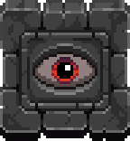

A heavy solid piece of stone that gets angry when Adam is underneath and tries to squash him.

|Property|Type|Description|
|-|-|-|
|script|string|`klonk_2.lua`|


### Landmine


Ugly piece of technology. When Adam steps onto one of these, it's time to run real quick.

|Property|Type|Description|
|-|-|-|
|script|string|`landmine.lua`|


### Minik Bomber


Don't judge him by his size. This little guy is a dangerous fellow, throwing bombs at you.

|Property|Type|Description|
|-|-|-|
|script|string|`minik_bomber.lua`|
|alignment|string|Whether the Minik Bomber is pointing `left` (default) or `right`.|
|velocity_x|float|Throw velocity in x (default is `nil`); If not set, Minik Bomber will automatically find a good value| 
|velocity_y|float|Throw velocity in y (default is `nil`); If not set, Minik Bomber will automatically find a good value| 
|interval_s|float|Throw interval in seconds (default is `nil`); if not set, Minik Bomber will throw when the player is in reach|


### Watermine

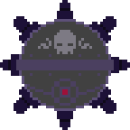

Another ugly piece of technology. Same concept as landmine but underwater.

|Property|Type|Description|
|-|-|-|
|script|string|`watermine.lua`|


